# Lab 9: Develop MapReduce Application Using Hadoop Cluster Setup

**Aim:** To set up a Hadoop cluster in a Linux environment and develop, execute, and verify a MapReduce application using the Hadoop Distributed File System (HDFS) and Hadoop MapReduce framework.

---

## Task 1: Hadoop Cluster Setup

### Step 1: Verify Java Installation
Check if OpenJDK 17 is installed and verify both the runtime and compiler:
```bash
java -version
javac -version
```
*(If not installed, run `sudo apt update && sudo apt install openjdk-17-jdk -y`).*

### Step 2: Install Hadoop
Extract the Hadoop 3.x archive, move it to `/usr/local/hadoop`, and set ownership to your user account:
```bash
tar -xzf hadoop-3.5.0.tar.gz
sudo mv hadoop-3.5.0 /usr/local/hadoop
sudo chown -R $USER:$USER /usr/local/hadoop
```

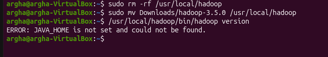
*Figure 9.1: Moving and setting ownership for Hadoop in `/usr/local/hadoop`.*

Verify the binary:
```bash
/usr/local/hadoop/bin/hadoop version
```

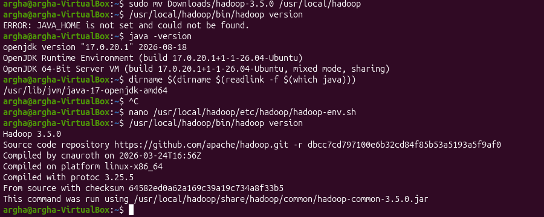
*Figure 9.2: Running Hadoop version check.*

### Step 3: Configure Environment Variables
Edit `~/.bashrc`:
```bash
nano ~/.bashrc
```
Append the following configuration:
```bash
export JAVA_HOME=$(dirname $(dirname $(readlink -f $(which javac))))
export HADOOP_HOME=/usr/local/hadoop
export HADOOP_INSTALL=$HADOOP_HOME
export HADOOP_MAPRED_HOME=$HADOOP_HOME
export HADOOP_COMMON_HOME=$HADOOP_HOME
export HADOOP_HDFS_HOME=$HADOOP_HOME
export YARN_HOME=$HADOOP_HOME
export HADOOP_COMMON_LIB_NATIVE_DIR=$HADOOP_HOME/lib/native
export PATH=$PATH:$HADOOP_HOME/sbin:$HADOOP_HOME/bin
export HADOOP_OPTS="-Djava.library.path=$HADOOP_HOME/lib/native"
```
Apply the changes:
```bash
source ~/.bashrc
```

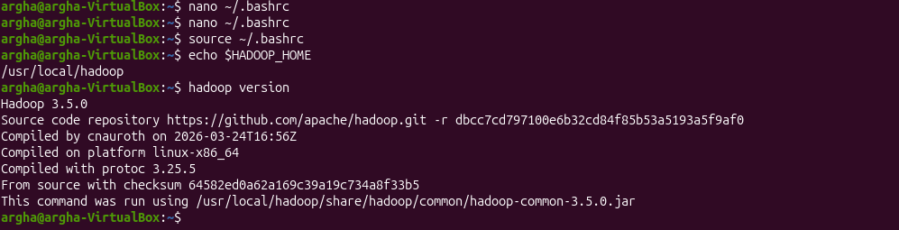
*Figure 9.3: Configuring environment variables in `~/.bashrc`.*

Also set `JAVA_HOME` explicitly in `/usr/local/hadoop/etc/hadoop/hadoop-env.sh`:
```bash
echo "export JAVA_HOME=$(dirname $(dirname $(readlink -f $(which javac))))" >> /usr/local/hadoop/etc/hadoop/hadoop-env.sh
```

### Step 4: Create HDFS Storage Directories
```bash
mkdir -p /usr/local/hadoop/data/hdfs/namenode
mkdir -p /usr/local/hadoop/data/hdfs/datanode
```

### Step 5: Configure `core-site.xml`
In `/usr/local/hadoop/etc/hadoop/core-site.xml`:
```xml
<configuration>
    <property>
        <name>fs.defaultFS</name>
        <value>hdfs://localhost:9000</value>
    </property>
</configuration>
```

### Step 6: Configure `hdfs-site.xml`
In `/usr/local/hadoop/etc/hadoop/hdfs-site.xml`:
```xml
<configuration>
    <property>
        <name>dfs.replication</name>
        <value>1</value>
    </property>
    <property>
        <name>dfs.namenode.name.dir</name>
        <value>file:///usr/local/hadoop/data/hdfs/namenode</value>
    </property>
    <property>
        <name>dfs.datanode.data.dir</name>
        <value>file:///usr/local/hadoop/data/hdfs/datanode</value>
    </property>
</configuration>
```

### Step 7: Configure `mapred-site.xml`
In `/usr/local/hadoop/etc/hadoop/mapred-site.xml`:
```xml
<configuration>
    <property>
        <name>mapreduce.framework.name</name>
        <value>yarn</value>
    </property>
    <property>
        <name>mapreduce.application.classpath</name>
        <value>$HADOOP_HOME/share/hadoop/mapreduce/*:$HADOOP_HOME/share/hadoop/mapreduce/lib/*</value>
    </property>
</configuration>
```

### Step 8: Configure `yarn-site.xml`
In `/usr/local/hadoop/etc/hadoop/yarn-site.xml`:
```xml
<configuration>
    <property>
        <name>yarn.nodemanager.aux-services</name>
        <value>mapreduce_shuffle</value>
    </property>
    <property>
        <name>yarn.nodemanager.env-whitelist</name>
        <value>JAVA_HOME,HADOOP_COMMON_HOME,HADOOP_HDFS_HOME,HADOOP_CONF_DIR,CLASSPATH_PREPEND_DISTCACHE,HADOOP_YARN_HOME,HADOOP_HOME,PATH,LANG,TZ,HADOOP_MAPRED_HOME</value>
    </property>
</configuration>
```

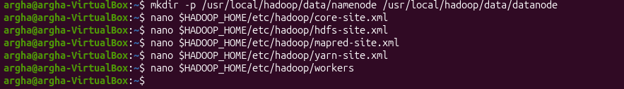
*Figure 9.4: Editing XML configuration files.*

### Step 9: Configure Worker Node
```bash
echo "localhost" > /usr/local/hadoop/etc/hadoop/workers
```

### Step 10: Configure Passwordless SSH
```bash
sudo apt install openssh-server openssh-client -y
sudo systemctl enable --now ssh
ssh-keygen -t rsa -P '' -f ~/.ssh/id_rsa
cat ~/.ssh/id_rsa.pub >> ~/.ssh/authorized_keys
chmod 0600 ~/.ssh/authorized_keys
ssh localhost
```

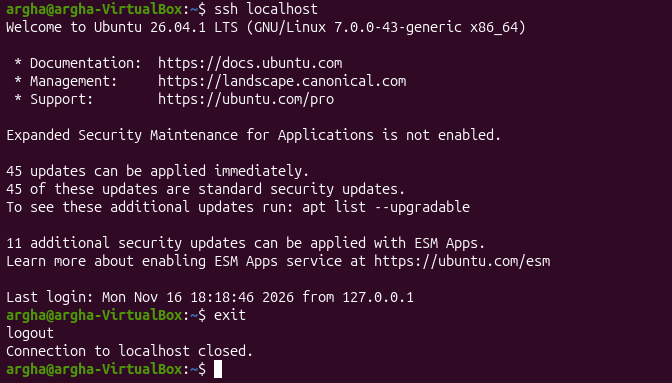
*Figure 9.5: Verifying passwordless SSH connection to `localhost`.*

---

## Task 2: HDFS Configuration and Basic Operations

### Step 1: Format the NameNode
```bash
hdfs namenode -format
```

### Step 2 & 3: Start Hadoop Services & Verify Daemons
```bash
start-dfs.sh
start-yarn.sh
jps
```
Verify that all 5 essential daemons are active:
- `NameNode`
- `DataNode`
- `SecondaryNameNode`
- `ResourceManager`
- `NodeManager`

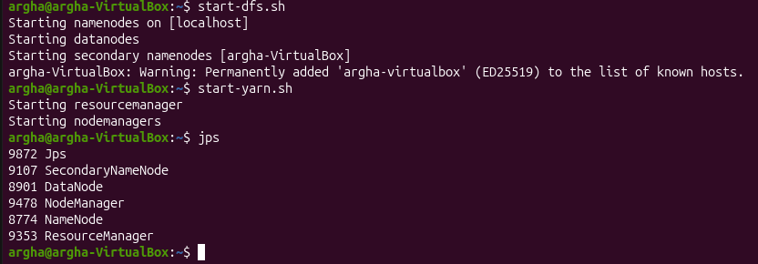
*Figure 9.6: Output of `jps` displaying running Hadoop HDFS and YARN daemons.*

### Step 4: Create HDFS Directory
```bash
hdfs dfs -mkdir -p /user/student/cloud-lab9/input
```

### Step 5 & 6: Create Local Sample Input File & Upload to HDFS
```bash
mkdir -p ~/cloud-lab9
cd ~/cloud-lab9
echo "cloud computing with apache hadoop" > input.txt
echo "hadoop distributed file system and mapreduce" >> input.txt
echo "cloud computing enables scalable distributed data processing" >> input.txt
echo "mapreduce processes big data across hadoop clusters" >> input.txt
hdfs dfs -put input.txt /user/student/cloud-lab9/input/
hdfs dfs -ls /user/student/cloud-lab9/input
```

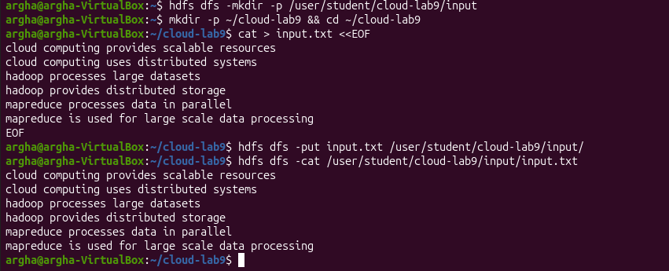
*Figure 9.7: Creating `input.txt` and uploading it to HDFS.*

---

## Task 3: Develop MapReduce Application

### Step 1: Create `WordCount.java`
Inside `~/cloud-lab9`, create `WordCount.java`:

```java
import java.io.IOException;
import java.util.StringTokenizer;
import org.apache.hadoop.conf.Configuration;
import org.apache.hadoop.fs.Path;
import org.apache.hadoop.io.IntWritable;
import org.apache.hadoop.io.Text;
import org.apache.hadoop.mapreduce.Job;
import org.apache.hadoop.mapreduce.Mapper;
import org.apache.hadoop.mapreduce.Reducer;
import org.apache.hadoop.mapreduce.lib.input.FileInputFormat;
import org.apache.hadoop.mapreduce.lib.output.FileOutputFormat;

public class WordCount {

    public static class TokenizerMapper extends Mapper<Object, Text, Text, IntWritable> {
        private static final IntWritable one = new IntWritable(1);
        private Text word = new Text();

        public void map(Object key, Text value, Context context) throws IOException, InterruptedException {
            StringTokenizer itr = new StringTokenizer(value.toString());
            while (itr.hasMoreTokens()) {
                word.set(itr.nextToken().toLowerCase());
                context.write(word, one);
            }
        }
    }

    public static class IntSumReducer extends Reducer<Text, IntWritable, Text, IntWritable> {
        private IntWritable result = new IntWritable();

        public void reduce(Text key, Iterable<IntWritable> values, Context context) throws IOException, InterruptedException {
            int sum = 0;
            for (IntWritable val : values) {
                sum += val.get();
            }
            result.set(sum);
            context.write(key, result);
        }
    }

    public static void main(String[] args) throws Exception {
        Configuration conf = new Configuration();
        Job job = Job.getInstance(conf, "word count");
        job.setJarByClass(WordCount.class);
        job.setMapperClass(TokenizerMapper.class);
        job.setCombinerClass(IntSumReducer.class);
        job.setReducerClass(IntSumReducer.class);
        job.setOutputKeyClass(Text.class);
        job.setOutputValueClass(IntWritable.class);
        FileInputFormat.addInputPath(job, new Path(args[0]));
        FileOutputFormat.setOutputPath(job, new Path(args[1]));
        System.exit(job.waitForCompletion(true) ? 0 : 1);
    }
}
```

### Step 2: Compile the Java Program
```bash
export HADOOP_CLASSPATH=$(hadoop classpath)
javac -classpath "$HADOOP_CLASSPATH" -d . WordCount.java
```

### Step 3: Package into a JAR File
```bash
jar -cvf wordcount.jar *.class
```

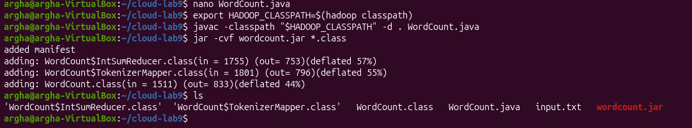
*Figure 9.8: Compiling Java source and building `wordcount.jar`.*

---

## Task 4: Execute MapReduce & Analyze Results

### Step 1 & 2: Submit the MapReduce Job
```bash
hdfs dfs -rm -r /user/student/cloud-lab9/output 2>/dev/null || true
hadoop jar wordcount.jar WordCount /user/student/cloud-lab9/input /user/student/cloud-lab9/output
```

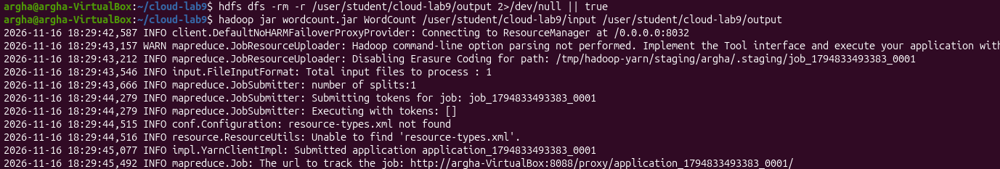
*Figure 9.9: Executing the MapReduce job on YARN.*

### Step 3: View Output Directory and Results
```bash
hdfs dfs -ls /user/student/cloud-lab9/output
hdfs dfs -cat /user/student/cloud-lab9/output/part-r-00000
```

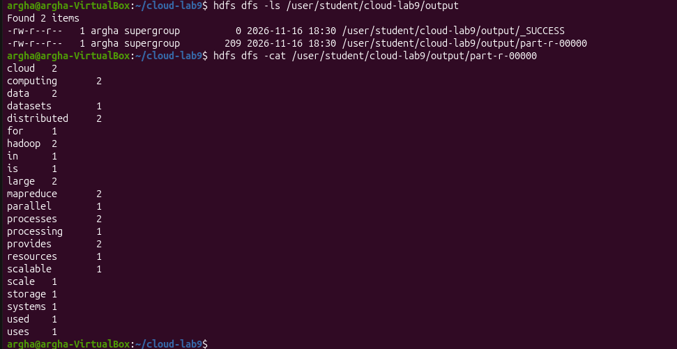
*Figure 9.10: Verifying word count calculation output in HDFS.*

---

### Task 4A: Explore Hadoop Web Interfaces
- **HDFS NameNode UI:** `http://localhost:9870`
- **YARN ResourceManager UI:** `http://localhost:8088`

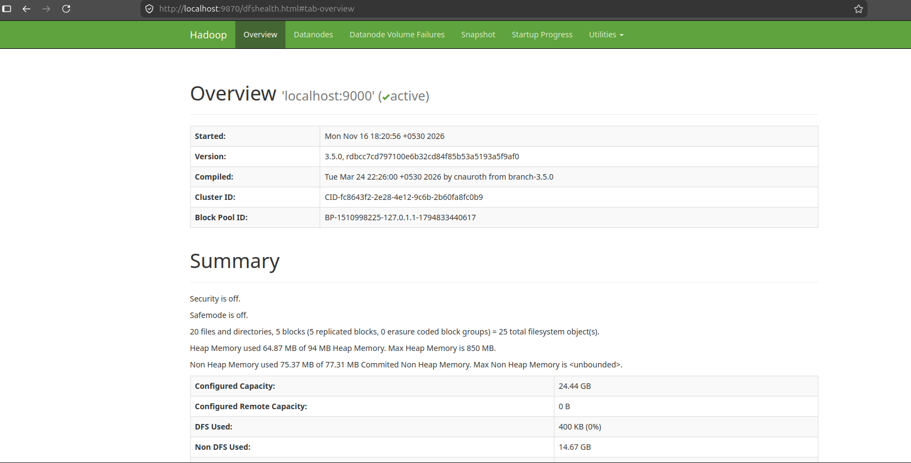
*Figure 9.11: HDFS NameNode Web Interface showing file system health and nodes.*

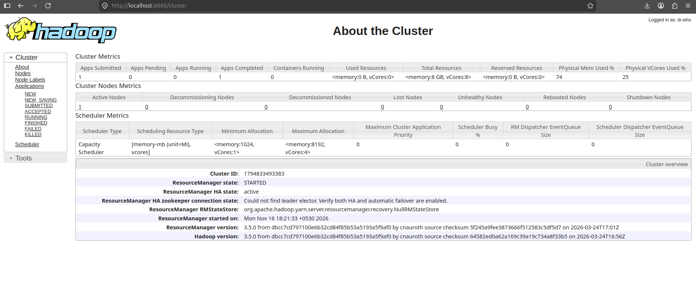
*Figure 9.12: YARN ResourceManager Web Interface showing completed MapReduce jobs.*

---

### Task 4B: Examine HDFS File Blocks
```bash
hdfs fsck /user/student/cloud-lab9/input/input.txt -files -blocks
```

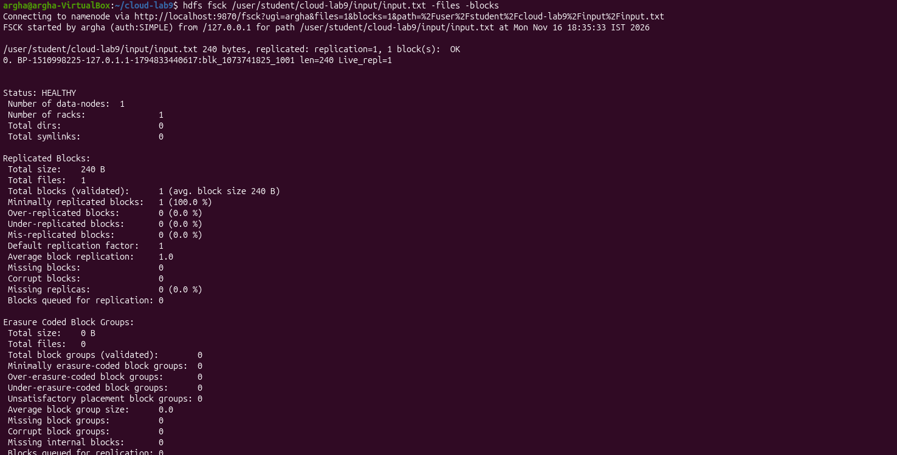
*Figure 9.13: Inspecting block allocation and status using `hdfs fsck`.*

---

### Task 4C: Additional HDFS File Operations
```bash
hdfs dfs -ls /user/student/cloud-lab9/input
hdfs dfs -get /user/student/cloud-lab9/input/input.txt downloaded.txt
cat downloaded.txt
```

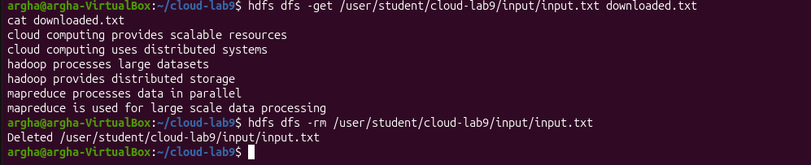
*Figure 9.14: Listing and downloading files from HDFS.*

---

### Task 4D: Stop Hadoop Services & Clean Verification
```bash
stop-yarn.sh
stop-dfs.sh
jps
```

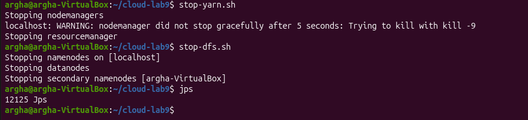
*Figure 9.15: Gracefully stopping daemons and verifying with `jps`.*

---

## Conclusion
A pseudo-distributed Hadoop cluster was successfully deployed and verified. An end-to-end MapReduce WordCount program was compiled, packaged, and executed over HDFS data, and Hadoop's cluster management interfaces were examined.
